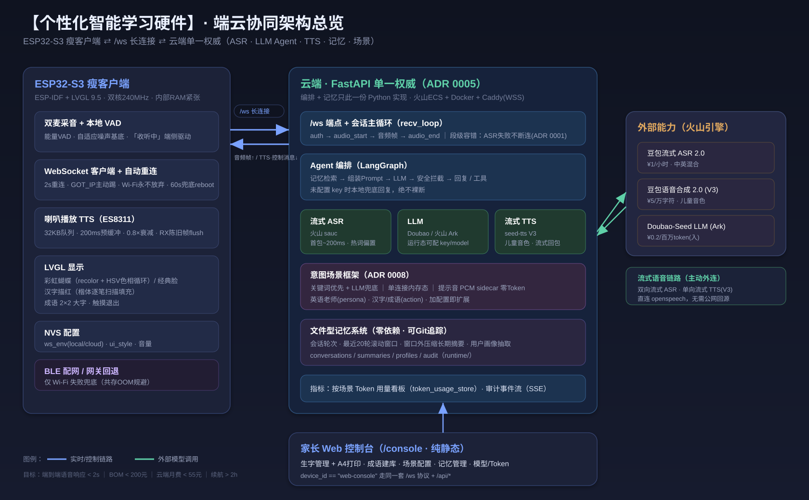

# 【个性化智能学习硬件】技术架构分享 · 端云协同的儿童 AI 语音机器人

> 面向技术分享场景。重点呈现**整体架构、关键链路、踩过的难点与攻关、以及若干创新点**。
> 最后更新：2026-06-27
> 配套素材：架构总览大图 [`assets/architecture-overview.svg`](./assets/architecture-overview.svg)（已导出）、`[视频：真机一轮完整语音交互]`、各章节标注的 `[图片：…]` 占位。

---

## 0. 一句话定位

一台**端云分离**的儿童 AI 语音伙伴：ESP32-S3 设备只做「复杂交互 + 语音 I/O」，云端用一份 Python 实现承载 **ASR → LLM Agent → TTS** 全链路、记忆与场景编排。
目标指标：**端到端语音响应 < 2s**、硬件 BOM < 200 元、云端月费 < 55 元。

---

## 0.5 产品视角：我们到底在解决什么问题

> 技术分享里加这一段，是为了让听众先理解「**为什么是这套架构**」——所有技术取舍都服务于产品诉求。

**用户是谁、痛点是什么。** 目标用户是 3–12 岁孩子和他们的家长。市面上同类「AI 玩具」的三个通病决定了我们的设计方向：

1. **响应慢、对话生硬** → 孩子没耐心。所以我们把「端到端 < 2s」当成硬指标，并为此承受了一整套端侧音频/时延工程的复杂度。
2. **要么是个只会播固定音频的玩具，要么是个不可控的开放对话黑盒** → 家长不放心。所以我们做了**内容安全护栏**（只聊学习/科普/故事/口算）+ **家长可控的记忆与场景**（看得见、改得动、删得掉）。
3. **千人一面，不懂这个孩子** → 用完即弃。所以我们做了**会成长的记忆系统**和**因人而异的人设/场景**。

**几条产品原则，直接塑造了架构：**

| 产品原则 | 对应的架构决策 |
| --- | --- |
| 孩子要能「独立操作」 | 离线唤醒词「你好小智」+ 语音即指令，不依赖按键/家长 |
| 硬件要便宜、要能量产 | BOM < 200 元 → 选内存紧张的 ESP32-S3 → 倒逼「瘦客户端 + 服务端权威」（ADR 0005） |
| 内容要安全、要可迭代 | LLM/记忆/安全/场景全在云端一份实现 → 改 prompt、加场景、修策略**不用重新烧固件** |
| 家长要有掌控感 | 文件型记忆（人类可读、可改可删）+ Web 控制台 + 按场景 Token 看板 |
| 学习内容要能持续运营 | 生字/成语「云端建库 + 端侧渲染」，运营同学在后台录入即可下发，不碰代码 |

**一句话总结产品视角下的架构哲学**：**把「变化快、要运营、要安全」的部分留在云端（软的、可热更新），把「实时、交互、体验」的部分做厚在端侧（硬的、要打磨）**——这条分界线就是后面所有「难点」和「创新」的来源。

---

## 1. 整体架构

### 1.1 顶层组成

> 架构总览大图（可缩放矢量图，浏览器/支持 SVG 的编辑器直接打开）：[`assets/architecture-overview.svg`](./assets/architecture-overview.svg)



下面是同一架构的 mermaid 源（便于在文档里直接渲染/二次编辑）：

```mermaid
flowchart LR
  subgraph Device[ESP32-S3 瘦客户端]
    MIC[双麦采音 + VAD] --> WSc[WebSocket 客户端]
    WSc --> SPK[喇叭播放 TTS]
    WSc --> LCD[LVGL 显示<br/>蝴蝶/经典脸/描红/成语]
    NVS[(NVS 配置)] --- WSc
  end

  Device <-->|"/ws 长连接<br/>音频帧 + 控制消息"| Server

  subgraph Server[云端 · FastAPI 单一权威]
    WSs[/ws 端点 + 会话主循环] --> AG[Agent 编排<br/>记忆检索→安全拦截→LLM]
    AG --> MEM[(文件型记忆<br/>会话/摘要/画像)]
    WSs --> ASR[流式 ASR · 火山 sauc]
    AG --> LLM[Doubao/Ark LLM]
    AG --> TTS[流式 TTS · seed-tts V3]
    SCENE[意图场景框架<br/>英语/成语/描红] --> AG
  end

  subgraph Console[家长 Web 控制台]
    UI[生字/成语/场景/记忆/Token]
  end
  Console <-->|"/api/* + /ws(web-console)"| Server
```

> 设备身份：`device_id == "web-console"` 视为控制台，其余为硬件设备（`_device_kind` 规则），两者共用同一套 `/ws` 协议。

### 1.2 技术栈

| 层 | 选型 | 说明 |
| --- | --- | --- |
| 主控 | ESP32-S3（微雪 1.83″ 触摸屏板） | 双核 240MHz、Wi-Fi+BLE、双麦+喇叭、锂电 |
| 固件 | ESP-IDF + LVGL 9.5 | 音频 I/O、显示、配网、WS 客户端 |
| 后端 | Python FastAPI | `/ws` 实时协议 + `/api/*` 管理 |
| LLM | Doubao-Seed / 火山 Ark | 运行态可配 key/model/prompt |
| ASR | 豆包流式语音识别 2.0 | 首包 ~200ms，软偏置热词 |
| TTS | 豆包语音合成 2.0（V3 流式） | 儿童音色，流式回包 |
| 记忆 | 文件系统（JSON/Markdown） | 零依赖、人类可读、可 Git 追踪 |
| 部署 | 火山 ECS + Docker Compose + Caddy | 自动 TLS WSS（ADR 0006） |

### 1.3 实时语音主链路

```
auth → audio_start → [二进制音频帧…] → audio_end
   └─ 服务端：流式 ASR(增量字幕) → Agent(记忆检索→安全→LLM) → TTS 流式
        → tts_start → [show_character_trace/show_idiom 可选] → 音频字节 → tts_end
```

---

## 2. 难点与攻关

> 这一节是分享的重点：每条都是**真实踩坑 → 定位根因 → 落地修复**，多数沉淀成了 ADR / 知识库。

### 难点 1：端侧音频质量——七个症状、七个根因

`16kHz/16bit` PCM 在这块内存紧张的板子上，几乎每个环节都会咬人。实测沉淀（`docs/knowledge/esp32-s3-audio-optimization.md`）：

| 症状 | 根因 | 修复 |
| --- | --- | --- |
| 全程「滋滋」底噪 | I2S TX DMA 队列耗尽时循环播旧缓冲 | `auto_clear=true` |
| 只播第一句就断 | 96KB 音频队列占满 `.bss`，挤垮 WS/TLS RX 缓冲 | 队列缩到 **32KB** |
| 上线后设备 offline | `dma_desc_num=8` 多占内部 RAM，auth 帧发不出 | 回退 `dma_desc_num=6` |
| 说话削顶「电流声」 | TTS PCM 近满幅（0 dBFS）过驱 DAC/功放 | 数字衰减 **×0.80（−1.9dB）** |
| 切句边界「咔哒」 | nominal 16kHz 与硬件时钟微差，队列抖向空 | 开播 **200ms 预缓冲** |
| ES8311 播放慢 3× | REG02（耳机输出路径）未清零，混音链叠延时 | `REG02=0x00` |

**要点**：这块板**内部 RAM 是第一约束**（启动时堆仅余 ~145KB）。音频缓冲、Wi-Fi/TLS、LVGL 画布在抢同一块 DMA-capable 内部 RAM——很多「玄学掉线」本质都是内存饥饿。

### 难点 2：半双工自激——「自问自答」根治

- **现象**：放 TTS 时设备把自己的声音当成用户输入，触发一轮新对话。
- **看似已修实则没根治**：`s_enabled=false` 期间 capture_task 只 idle 不读 RX，但 **I2S RX DMA 在整个放音期间持续缓冲**，采到的全是喇叭自己的声音；放音结束重新使能采集，第一批 `i2s_channel_read` 读到的是这堆**陈旧帧** → VAD 触发 → 送 ASR → 自答。早期「TTS 结束延后 200ms」并没清这个缓冲。
- **根治**：重新使能采集前，先**非阻塞排空 RX DMA 的陈旧数据**再开始真实读取（`s_flush_pending`）。

```c
// firmware/main/audio_capture.c —— 重新开麦前排空放音期间缓冲的陈旧帧
void voice_audio_capture_set_enabled(bool enabled) {
    if (s_enabled == enabled) return;
    if (enabled) {
        // 先置标志、再翻 s_enabled，确保采集任务在真正读取前先 flush
        s_flush_pending = true;
    }
    s_enabled = enabled;
}

// 采集任务循环里：
if (s_flush_pending) {
    // 用 timeout=0 非阻塞地把 RX DMA 里放音期间采到的“喇叭自己的声音”读干净
    size_t drained = 0, got = 0;
    while (i2s_channel_read(rx, stereo, CAPTURE_FRAME_BYTES, &got, 0) == ESP_OK && got) {
        drained += got;
    }
    s_flush_pending = false;
    ESP_LOGI(TAG, "capture flushed %u stale bytes", (unsigned)drained);
}
```

> 关键是 `i2s_channel_read(..., 0)` 的 **timeout=0**：把 DMA 里已堆积的陈旧帧一次性读空，之后第一帧才是用户真实说话。早期「TTS 结束延后 200ms」只是等，并没清这块缓冲，所以治标不治本。

### 难点 3：「收听中」偶发卡很久——VAD 尾静音的自适应噪声基底

- **现象**：用户反馈「有时候『收听中』要等很久才有反应」。
- **定位**：`收听中` 状态**完全由设备本地 VAD 驱动**，服务端无法延长——所以与云端 ASR/LLM 无关。
- **根因**：能量 VAD 用**固定** `end_threshold`。房间底噪（风扇/空调）平均幅度一旦超过它，`silence_streak` 永远攒不够 → `SPEECH_END` 不触发 → 卡到 `max_utterance_frames`（15s 硬上限）。间歇性正源于环境噪声。
- **创新解法**：说话前的聆听间隙用**快 EMA** 估计房间底噪 `noise_floor`，进入说话后**有效尾静音阈值 = max(固定阈值, noise_floor×1.8)** 并以 `start_threshold` 封顶。无论房间多吵，能量回落到底噪附近即可判定「说完」；句中 <240ms 短停顿不误断；`noise_floor` 跨回合保留、跨场景自适应。

```c
// firmware/main/vad.c —— 自适应尾静音阈值（end_noise_mult_x10 默认 18 ≈ ×1.8）
if (!vad->in_speech) {
    // 说话前的安静窗口：~4 帧时间常数的快 EMA 估计房间底噪
    vad->noise_floor += (energy - vad->noise_floor) / 4;
    ...
}

// 进入说话后：把固定地板抬到“底噪的若干倍”，并以 start_threshold 封顶
int end_threshold = vad->config.end_threshold;
if (vad->config.end_noise_mult_x10 > 0) {
    int relative = vad->noise_floor * vad->config.end_noise_mult_x10 / 10;
    if (relative > end_threshold)              end_threshold = relative;          // 吵 → 抬高
    if (end_threshold > vad->config.start_threshold)
        end_threshold = vad->config.start_threshold;                              // 不超过起说阈值
}
if (energy < end_threshold) vad->silence_streak++; else vad->silence_streak = 0;
bool trailing_silence = vad->silence_streak >= vad->config.end_silence_frames;
```

> 设计巧思：`noise_floor` 只在 `!in_speech`（没说话）时更新，避免把人声当底噪；`end_noise_mult_x10=0` 即退回旧的固定阈值行为，老单测显式置 0 保证行为不变——**新能力默认开，但可一键关回老行为**，是这类「自适应」改动安全落地的常用手法。

### 难点 4：连接可靠性——可恢复故障不能升级成断连

几条独立的「连接被误杀」问题，逐个收口：

- **ASR 上游失败拖垮整条 `/ws`（ADR 0001）**：`feed()` 第一帧才懒连火山 ASR，连接/鉴权失败抛 `RuntimeError`，无人捕获 → 冲出 `recv_loop` → 拆 task group → `websocket.close(1000)`。**现象是每次语音都「disconnected 1000」且吞掉真实错误**。
  **修复**：段级容错 `_fail_audio_segment`——只中止当前语音段，向客户端发 `error`（含中文 advice），**绝不拆连接**；与 TTS 失败路径行为一致。

```python
# voice_robot/server.py —— ASR 上游失败只中止当前语音段，连接保持可用
async def _fail_audio_segment(exc: Exception) -> None:
    nonlocal asr_session, asr_session_failed
    asr_session_failed = True                 # 本段后续音频帧静默丢弃，直到 audio_end
    if asr_session is not None:
        try:
            await asr_session.aclose()        # best-effort 拆掉这一段的上游会话
        except Exception:
            pass
        asr_session = None
    await _send_control(websocket, ServerControlMessage(
        type="error", message=f"speech recognition failed: {exc}"))  # 真实原因直达客户端
    _audit(user_id, event_type="speech_turn_error", payload={"error": str(exc)})
```

> 本质是把「**可恢复的上游故障**」与「**连接生命周期**」解耦：`feed()` 必须留在 `recv_loop` 里保证帧顺序，但它抛的异常不能再冒泡去拆 task group。否则用户只看到一个无信息的 `close 1000`，连「key 没授权」这种自助可修的原因都被吞掉。
- **固件 WS 重连**：`esp_websocket_client` 每 2s 重连 + Wi-Fi 恢复时 `IP_EVENT_STA_GOT_IP` **主动踢 stop+start** + 60s 无连接 reboot 兜底；开机首次连上后 Wi-Fi 断线**无限重试**（不再限 8 次）。
- **uvicorn ping 超时误判**：硬件在「收 TTS + 紧接录音」满负荷期来不及回 WS Pong，默认 20s ping 超时会误判掉线。设备已有 15s 应用层心跳，故服务端放宽 `--ws-ping-timeout 180`。
- **生产磁盘撑满连锁故障**：`turns.jsonl.*.bak` 备份累积 13GB 撑满 20GB 磁盘 → `console_settings.json` 写入截断成非法 JSON → 所有 API 500。修：清 `.bak` + 修复截断 JSON + 重启，并把排查流程写进 runbook。

### 难点 5：BLE + Wi-Fi 共存 OOM——boot loop

- **现象**：真机接上后云端 `hardware_online:0`、串口无限 `Rebooting...`，但 Wi-Fi 其实已连上。
- **根因**：Wi-Fi 在线时**并发起 BLE 控制器**，`E BLE_INIT: Malloc failed` → 链路层初始化崩溃重启。**关键认知**：BT 控制器链路层核心缓冲**必须用 DMA-capable 内部 RAM，PSRAM 无法 back**；Wi-Fi+LVGL+音频+描红画布已吃掉内部 RAM。
- **修复**：BLE 本就是 **Wi-Fi 失败兜底**，Wi-Fi 在线时不再并发起 BLE。

### 难点 6：公网链路时延

- **按需隧道**：首次发起 ASR 才起 cloudflared 公网隧道并等边缘就绪（最长 ~25s），首轮稍慢、之后复用。
- **逐项压时延**：VAD 尾静音 700→240ms、TTS 预缓冲 6KB→4KB、思考超时 20s→8s，单回合固件侧固定延迟从 ~830ms 降到 ~650ms。
- **LLM 读超时**：成语「解读+故事」640 token 在 20s 读超时下退化成兜底模板 → 成语生成单独放宽到 60s。

---

## 3. 创新点

### 创新 1：架构演进——果断回退「端侧自治」到「服务端权威 + 瘦客户端」（ADR 0005）

- 曾经走过**端侧自治**：固件用 C 复刻 ASR→LLM→TTS + 端侧记忆 + 设备直连火山云（11 个 `vr_*` 模块）。
- 产品方向改为「服务端发布到公网供外网访问」后，端侧自治的核心代价（**编排 + 记忆两份实现** + 固件里 3 个流式云客户端 + flash 读写）不再值得。
- **关键洞察**：那 11 个自治模块虽然编进 build、有 host 测试，但**从未接入实时对话通路**——一直是「在场但未接线」。于是回退=**删除未接线代码**，瘦客户端通路本就完整。
- **收益**：编排+记忆回到单一 Python 实现，消除双份漂移；固件显著瘦身（去 LittleFS/cJSON/HTTP-TLS/Ark 客户端）。

### 创新 2：动态变色蝴蝶 UI——单精灵 recolor + HSV 色相循环（ADR 0007）

- 需求：蝴蝶**不断变换鲜艳色彩** + 翅膀煽动 + 跟随语音状态切表情。约束：SPI 24MHz、~11Hz 刷新、flash/内部 RAM 都紧张。
- **没选**多帧彩色位图（flash = 帧数×尺寸×颜色数，轻松上 MB，变色离散）。
- **选了**：蝴蝶底图画成**纯白描边**（辉光用 alpha 叠层），运行时 `lv_color_hsv_to_rgb` 每 2~3 tick 旋一次色相 + `image_recolor(LV_OPA_COVER)` 整只上色；翅膀 3 帧切换扇动。
- **收益**：一套白图 ≈373KB（vs 多帧成倍增长）、变色平滑可调速，复用了汉字描红 canvas 的 A8+recolor 管线。代价：recolor 触发整块 invalidate 是 SPI 热点，靠「限面积 + 降频换色 + 仅值变化才刷」压住。

```c
// firmware/main/display_lcd.c —— 整只蝴蝶用一张白图 + recolor 做 HSV 色相循环
uint8_t hue_step = (s_cur_screen == VOICE_UI_SCREEN_PLAYBACK) ? 9 : 6;  // 说话时转更快
s_bf_hue = (uint16_t)((s_bf_hue + hue_step) % 360u);
if ((int)s_bf_hue != s_last_bf_hue) {          // 仅当色相真的变了才刷，压 SPI 负载
    s_last_bf_hue = (int)s_bf_hue;
    lv_color_t wc = lv_color_hsv_to_rgb(s_bf_hue, 92, 100);            // 翅膀：高饱和
    lv_obj_set_style_image_recolor(s_img_bf_wing, wc, 0);
    lv_obj_set_style_image_recolor_opa(s_img_bf_wing, LV_OPA_COVER, 0);
    lv_color_t bc = lv_color_hsv_to_rgb((s_bf_hue + 50u) % 360u, 65, 95); // 蝶身：错相 50°
    lv_obj_set_style_image_recolor(s_img_bf_body, bc, 0);
    lv_obj_set_style_image_recolor_opa(s_img_bf_body, LV_OPA_COVER, 0);
}
```

> 两处细节体现「省带宽」的克制：① 蝶身用 `hue+50°` 的**错相**配色，单 hue 变量就出双色层次；② `LV_OPA_COVER` 让 recolor 完全覆盖白底，辉光浓淡完全由原图 alpha 表达——所以底图只需画一张白的。

### 创新 3：汉字描红——云端出笔画、端侧逐笔楷体扫描填充

- 云端在 ASR 结果/文本上做**单字描红意图识别**（剥离填充词、严格候选校验，故意拒绝「怎么写十字」这类动词在前的误匹配），命中才下发 `show_character_trace` 笔画 payload，并把当前轮回复切成**离线写法讲解**（不依赖外网）。
- 端侧用**楷体轮廓偶奇扫描线填充** + A8 画布逐笔显影，复杂字放慢节奏；**点一次重播、点两次退出**。
- 成语进一步做 **2×2 大字**：端侧字符串感知的花括号配对切出每个字形，逐字复用一份缓冲解析渲染（不同时持有整条成语字形，省 RAM）。

### 创新 4：可扩展意图场景框架——零成本进场景、零 Token 提示音（ADR 0008）

- **意图识别 = 关键词优先 + LLM 兜底**：关键词命中即**零 Token**进入；仅在未命中但出现「弱学习信号」粗筛词时调一次轻量 LLM 分类——绝大多数普通对话不触发 LLM。

```python
# voice_robot/scenes/intent.py —— 先零成本关键词，再用“粗筛词”当 LLM 的闸门
def match_enter_keyword(text, scenes):
    normalized = (text or "").lower()
    for scene in scenes:
        for keyword in scene.enter_keywords:        # Web 可编辑的触发词
            if keyword.strip().lower() in normalized:
                return scene                         # 命中 → 零 Token 直接进场景

def has_learning_signal(text: str) -> bool:          # 仅作为是否值得调 LLM 的闸门
    normalized = (text or "").lower()
    return any(term in normalized for term in LEARNING_SIGNAL_TERMS)  # 英语/English/学/练…
```

> 编排逻辑：`match_enter_keyword` 未命中**且** `has_learning_signal` 为真，才调一次受限输出的 LLM 分类。于是「今天天气怎么样」这种普通对话连粗筛闸门都过不了，**永远不会**为意图识别付 LLM 成本；只有「我想……练练口语？」这类模糊表达才触发兜底。退出判定则走**纯关键词**（指令明确，省成本、降误退）。
- **场景状态 = 单连接内存态**：`current_scene` 随 `/ws` 连接，契合瘦客户端，无持久化心智负担。
- **固定进出提示音 = 持久化 PCM sidecar 缓存**（key = 文案 hash + voice + 采样率 + 编码）：命中即**零 Token**，文案/音色变更自动重合成。
- **可扩展性已验证**：monkeypatch 注入 `math_tutor` 即可让 registry/API/意图/人设注入**全链路零改码生效**。当前已落地英语学习（持久人设 + 语音退出 + ASR 热词 + 切「经典脸」）与成语/汉字（一次性动作场景）。

### 创新 5：全双工打断——分三期演进，不假装验证（ADR 0002）

放音中插话的本质障碍是**声学回声**。路线图分三期：
1. **0.5 软件验证**：Web「真机模拟」放音不关麦 + 浏览器 `echoCancellation`，先验证 barge-in 状态机/协议。
2. **1.0 唤醒词打断**：esp-sr WakeNet，放音中靠唤醒词打断。
3. **2.0 自由插话**：esp-sr AFE + **软件数字参考 AEC**（TTS 的 PCM 本就是设备自己写进 I2S 的，手里已有完美远端参考，省掉硬件 loopback）。

**方法论亮点**：状态机这类「信号无关」逻辑可 host 注入帧/事件先测；但 **DSP 本体（WakeNet 检出率/AEC 收敛/时延对齐）必须真机验收**——不得用浏览器 AEC 冒充 esp-sr 的证据。

### 创新 6：文件型记忆系统——零依赖、人类可读、可演进

- 分层文件存储：`ConversationStore`（轮次）+ `SummaryStore`（长期摘要）+ `AuditLogStore`（审计）+ `ProfileMemoryExtractor`（画像抽取）。
- **最近 20 轮**滚动窗口作短期记忆，窗口外每 20 轮**压缩为长期摘要**，二者都拼进上下文。
- 家长可在控制台**查看/改/删**单条记忆（删前确认），数据可控、可迁移、可 Git 追踪。

---

## 4. 工程方法论（也值得分享）

- **文档驱动 / SDD**：大改动先落 `docs/design/plans/`，有取舍的决策先写**不可变 ADR**（被取代时标 `Superseded by`）。本分享几乎每个难点/创新都能溯源到一条 ADR。
- **「不假装验证」原则**：能 host C 单测 + 模拟器验证的逻辑层先验证；端侧 DSP/真机体感**必须真机验收**，不拿模拟器证据冒充。
- **三级验证**：host C 单测 → Web「真机模拟」闭环 → 真机烧录验收；后端任何改动 `pytest -q` 全绿（当前 430+ passed）。
- **数据安全红线**：调试 API 只 GET，**绝不向生产写测试数据**（曾因覆盖丢过用户分组数据）。

---

## 5. 关键指标与成本

| 维度 | 指标 |
| --- | --- |
| 端到端语音响应 | < 2s（Wi-Fi 环境） |
| ASR 首包 | ~200ms |
| 固件侧单回合固定延迟 | ~830ms → **~650ms**（优化后） |
| 硬件 BOM | < 200 元 |
| 云端月费 | < 55 元 |
| 续航 | 连续对话 > 2h |
| 后端测试 | `pytest -q` 430+ passed |

---

## 6. 演进路线（Roadmap）

- 全双工打断 1.0 / 2.0（WakeNet → AEC 数字参考）真机落地与标定。
- 端到端时延精细归因（固件加 `audio_end→asr_result` 时间戳，定位 VAD/ASR/LLM 各占比）。
- 更多意图场景（数学等）按「加配置 + 默认人设」零改主链路扩展。
- 公网链路下 ASR 流式首包 / TTS 无缝播放的长稳观测。

---

## 素材清单（待补）

- [x] 架构总览大图 → `assets/architecture-overview.svg`（已导出，可再转 PNG 用于 PPT）
- [ ] 真机一轮完整语音交互视频（唤醒→识别→回答→TTS）
- [ ] 音频优化前后对比波形/录音
- [ ] 蝴蝶变色 + 表情切换录屏
- [ ] 描红逐笔 / 成语 2×2 大字录屏
- [ ] 控制台场景配置 + Token 看板截图

---

*技术细节以 `docs/prd/`、`docs/knowledge/`（含 `decisions/` ADR）为准；本文为分享用的提炼视图。*
